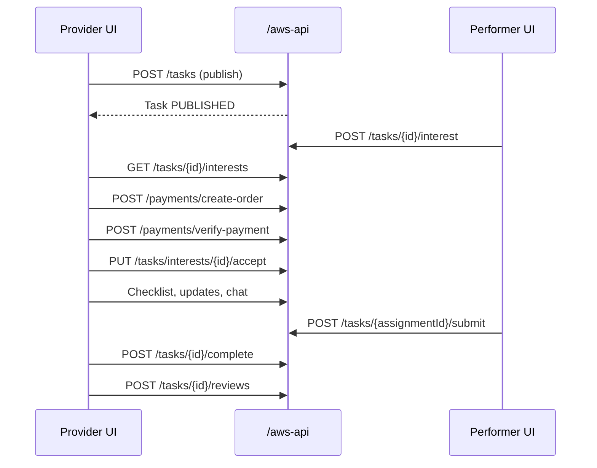
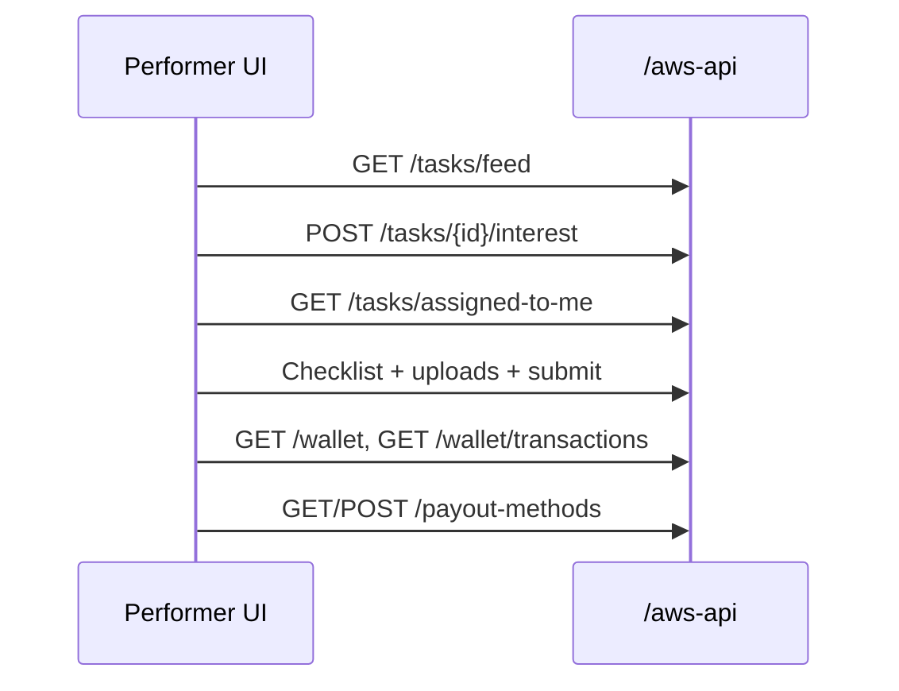
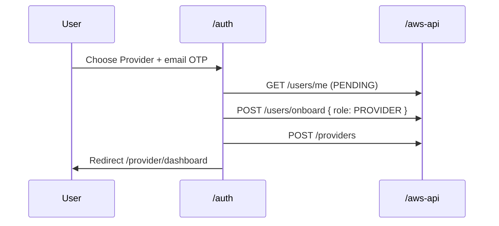

# OnIT India — End-to-End Dynamic Features

> **Last updated:** June 2026  
> **Scope:** What is wired to real backend APIs and updates dynamically vs static/UI-only areas.  
> **Backend:** NestJS via `/aws-api` (Vite proxy). AI helpers via local Express `/api`.

---

## How to read this doc

| Label | Meaning |
|-------|---------|
| **Dynamic (E2E)** | Real API read/write; data comes from backend and actions persist |
| **Partial** | Mix of API data + hardcoded UI, localStorage, or client-side inference |
| **Static** | No backend; mock data, navigation-only, or local files only |

---

## Architecture overview

```
┌─────────────────┐     Auth0 / MSG91      ┌──────────────────┐
│  AuthPage /auth │ ─────────────────────► │  NestJS /aws-api │
└────────┬────────┘     JWT onit_token     │  users, tasks,   │
         │                                  │  wallet, chat…   │
         ▼                                  └────────▲─────────┘
┌─────────────────┐                               │
│ ProviderApp     │  ProviderDataContext          │
│ PerformerApp    │  (poll + cache tasks)         │
│ admin-onit      │  admin_token                  │
└─────────────────┘                               │
         │                                        │
         └──────── Express /api (AI only) ───────┘
                  POST /api/ai-task
                  POST /api/enhance-description
```

**Shared auth:** `AuthContext` → `GET /users/me`, token refresh, role (`PROVIDER`, `TASKER`, `ADMIN`).

**Notifications:** `NotificationContext` → `GET /notifications`, mark read, Socket.IO `notification.new`.

**Gated routes:** `/provider/*` and `/performer/*` require auth + correct role (`GatedRoute`).

---

## 1. Authentication & onboarding (Dynamic E2E)

| Flow | Route | APIs | Notes |
|------|-------|------|-------|
| Sign up / log in (email OTP) | `/auth` | Auth0 passwordless + `GET /users/me` | Provider or performer chosen on role screen |
| Sign up / log in (Google) | `/auth` | Auth0 popup + onboard APIs | |
| New provider onboarding | `/auth` → dashboard | `POST /users/onboard`, `POST /providers` | Creates provider profile |
| New performer onboarding | `/auth` → dashboard | `POST /users/onboard`, `POST /taskers` | Creates tasker profile |
| Provider app bootstrap | `/provider/*` | `GET /users/me`, auto-create provider if missing | Redirects taskers away |
| Performer app bootstrap | `/performer/*` | `GET /users/me`, auto-create tasker if missing | Redirects providers away |
| Delete account | `/provider/delete-account` | `POST /users/me/delete/otp`, `DELETE /users/me` | OTP-gated |
| Phone verification gate | Wraps apps | MSG91 + profile phone APIs | **Currently disabled** (`PHONE_OTP_DISABLED = true`) |

**Single auth page:** `client/src/components/provider/pages/AuthPage.jsx` at `/auth` for both roles.

---

## 2. Provider — fully dynamic E2E flows

### 2.1 Dashboard & task list (dynamic data)

| Feature | Route | APIs | Refresh |
|---------|-------|------|---------|
| Stat cards (Applicants, Active, Completed, Drafts) | `/provider/dashboard` | `GET /tasks/my-posted-tasks`, `GET /providers/me` | `ProviderDataContext` — session cache, ~10s poll, focus refresh |
| Recent / live tasks on dashboard | `/provider/dashboard` | Same task list | Filtered client-side |
| Recommended performers carousel | `/provider/dashboard` | `GET /taskers?sortBy=rating_desc&limit=10` | Via context |

**Partial on dashboard:** Task spotlight (status from API; views/match % often defaulted). Browse by Category (static grid → navigates to templates). Domain explorer filters static categories over API data.

---

### 2.2 Post a task (Dynamic E2E)

```
Post task manual → POST /tasks (+ uploads) → appears in My Tasks / dashboard
```

| Step | Route | APIs |
|------|-------|------|
| Write & publish task | `/provider/post-task-manual` | `POST /tasks`, `POST /uploads/presigned-url`, `POST /uploads/confirm` |
| Save as draft | Same | `POST /tasks` with draft status |
| Publish draft later | `/provider/my-tasks` | `POST /tasks/{id}/publish` |
| AI-assisted prefill | `/provider/post-task-ai` | `POST /api/ai-task` (Express) → forwards to manual post |

**Static in posting:** Category/skill pickers use local lists. AI “specialist matches” are hardcoded names, not `GET /taskers`.

---

### 2.3 Hire a performer (Dynamic E2E)

```
Browse taskers → express interest (performer) → provider accepts → Razorpay → assignment active
```

| Step | Route | APIs |
|------|-------|------|
| Browse performers | `/provider/task-performers`, `/provider/explore-talent` | `GET /taskers` |
| View performer profile | `/provider/task-performer-profile/:id` | `GET /taskers/{id}`, reviews, interests |
| View applicants | `/provider/task-applicants?taskId=` | `GET /tasks/provider/{id}`, `GET /tasks/{id}/interests` |
| Confirm & pay / hire | `/provider/confirm-and-pay` | `POST /payments/create-order`, `POST /payments/verify-payment`, `PUT /tasks/interests/{id}/accept`, `POST /tasks/{id}/direct-hire` |

**Saved performers:** IDs in `localStorage`; profiles loaded from API.

---

### 2.4 Active task lifecycle (Dynamic E2E)

| Feature | Route | APIs |
|---------|-------|------|
| Task execution hub | `/provider/active-task/:id` | `GET /tasks/provider/{id}` |
| Checklist | Same | `GET/POST/PATCH /tasks/{id}/checklist`, tick items |
| Work updates | Same | `GET/POST /tasks/updates/{assignmentId}` |
| Mark complete | Same | `POST /tasks/{assignmentId}/complete` |
| Leave review | Same | `POST /tasks/{id}/reviews` |
| Chat with performer | `/provider/chats` | Conversations + messages APIs |

---

### 2.5 My tasks & history (Dynamic E2E)

| Feature | Route | APIs |
|---------|-------|------|
| All task tabs | `/provider/my-tasks` | `GET /tasks/my-posted-tasks` |
| Drafts | `/provider/draft-tasks` | Same (filter `DRAFT`) |
| History | `/provider/task-history` | Same (filter completed/active) |

Client-side tab filtering; list refetches on interval (~12s on My Tasks).

---

### 2.6 Chats (Dynamic E2E)

| Tab | Route | APIs |
|-----|-------|------|
| Performer DMs | `/provider/chats` | `GET /conversations`, messages, send, mark read |
| Support | `/provider/chats` | `GET/POST /support/tickets`, ticket messages |

**Local only:** Pin, star, archive → `localStorage` (`chatPreferences.js`), not on backend yet.

---

### 2.7 Wallet & payouts (Dynamic E2E)

| Feature | Route | APIs |
|---------|-------|------|
| Balance | Settings → Wallet | `GET /wallet` |
| Add funds (Razorpay) | Settings wallet flow | `POST /payments/create-order`, verify |
| Withdraw | Settings wallet flow | `GET /payout-methods`, `POST /wallet/withdraw` |
| Bank / payout methods | Settings → Banks | `GET/POST/DELETE /payout-methods` |
| Recent transactions (wallet tab) | Settings → Wallet | `GET /wallet/transactions?limit=5` |

**Static:** “Linked payment methods” display in wallet UI (Google Pay/Paytm labels). Transactions settings tab uses mock rows.

---

### 2.8 Settings (Dynamic E2E)

| Tab | Route | APIs |
|-----|-------|------|
| Edit profile | `/provider/settings` | `GET/PUT /providers/me`, uploads, `PUT /users/me` |
| Job descriptions / saved templates | Profile settings, `/provider/task-templates` | `GET/POST/PUT/DELETE /templates` |
| Ratings received | Ratings tab | `GET /providers/me`, `GET /providers/{id}/reviews` |
| Refer & earn | Refer tab | `GET /referral/me` |

**Static / partial:** Provider insights (charts mock), reviews given, subscription plan UI, transactions list mock.

---

## 3. Performer — fully dynamic E2E flows

### 3.1 Discover & apply (Dynamic E2E)

| Feature | Route | APIs |
|---------|-------|------|
| Task feed (dashboard) | `/performer/dashboard` | `GET /tasks/feed`, `GET /tasks/assigned-to-me`, `GET /wallet`, `GET /taskers/me` |
| Search tasks | `/performer/search-results` | `GET /tasks/search` |
| Task detail | `/performer/task/:id` | `GET /tasks/{id}`, `GET /providers/{id}` |
| Show interest | Task detail / feed | `POST /tasks/{id}/interest` |
| My tasks (assigned + interests) | `/performer/my-tasks`, `/all-tasks` | `GET /tasks/assigned-to-me`, `GET /tasks/my-interests` |

---

### 3.2 Execute & submit (Dynamic E2E)

| Feature | Route | APIs |
|---------|-------|------|
| Active task | `/performer/active-task/:id` | `GET /tasks/{id}`, checklist, uploads, updates, submit, review |
| Submit work | Same | `POST /tasks/{assignmentId}/submit` |
| Rate provider | Same | `POST /tasks/{id}/reviews` |

---

### 3.3 Profile, KYC, wallet (Dynamic E2E)

| Feature | Route | APIs |
|---------|-------|------|
| Edit profile | `/performer/profile` | `GET/PUT /taskers/me`, `PUT /users/me`, S3 uploads |
| KYC | `/performer/kyc` | `GET/POST /taskers/me/kyc`, uploads |
| Wallet / earnings | `/performer/wallet`, `/earnings` | `GET /wallet`, `GET /wallet/transactions` |
| Payout methods | `/performer/banks` | `GET/POST/DELETE /payout-methods` |
| Ratings received | `/performer/ratings` | `GET /taskers/{id}/reviews` |
| Refer & earn | `/performer/refer` | `GET /referral/me`, `GET /wallet` |
| Chats | `/performer/chats` | Same conversation APIs as provider |

**Not wired:** Withdraw page UI (`POST /wallet/withdraw` exists in api.js but not called). Vouchers, saved tasks, applications pages are placeholders.

---

## 4. Admin — fully dynamic E2E flows

| Feature | Route | APIs |
|---------|-------|------|
| Dashboard analytics | `/dashboard` | `GET /admin/analytics/dashboard`, growth |
| Users | `/users` | List, block, activate |
| Tasks | `/tasks`, `/tasks/:id` | List, detail, `PATCH /admin/tasks/{id}/status`, resolve assignments |
| Task approvals | `/task-approvals` | Approve / reject posted tasks |
| Finance | `/finance` | Transactions list, status updates |
| Performer KYC | `/verify-performers` | Pending KYC, verify documents |
| Work verification | `/verify-work` | Approve / reject submitted work |
| Moderation | `/moderation` | Reviews list, delete |
| Support tickets | `/support/tickets` | Full ticket CRUD + messages |
| Live support chat | `/support/live-chat` | Tickets + Socket.IO |
| Notifications | `/notifications` | Broadcast + scheduled notifications |
| Referrals & coupons | `/promotions/*` | Milestones, fulfillments, coupon CRUD |
| Careers | `/careers` | Jobs + applications |
| Bulk deletion | `/deletion` | Bulk delete users/tasks |
| Platform settings | `/settings` | Bulk settings upsert |

**Note:** Admin “Abort task” currently uses `PATCH /admin/tasks/{id}/status`, not `POST /tasks/{id}/cancel`. Provider `cancelTask` API exists in client but is **unused**.

---

## 5. ProviderDataContext — central dynamic cache

**File:** `client/src/components/provider/contexts/ProviderDataContext.jsx`

| Exported | Source API | Used by |
|----------|------------|---------|
| `stats` | Derived from `listMyTasks` + provider profile | Dashboard stat cards |
| `activities` | `GET /tasks/my-posted-tasks` (mapped) | Dashboard tasks, spotlight, task-status, task-activity |
| `performers` | `GET /taskers?limit=10` | Dashboard performers, talent card |
| `refreshData()` | Re-fetches all above | After actions, notifications, focus |

**Caching:** Session-level cache + polling (~10s) + refresh on window focus and notification events.

---

## 6. Static or UI-only (not dynamic E2E)

### Provider

| Item | Why static |
|------|------------|
| Browse by Category grid | `BROWSE_CATEGORIES` constant; navigates only |
| Task templates page | `GET /templates` (provider saved templates) |
| AI specialist matching (`AIChatTaskFlow`, `TaskMatchingFlow`) | Hardcoded `SPECIALISTS` array |
| Task spotlight metrics | Default views/match % when API omits fields |
| Boost task, payment selection/success pages | Mock UI |
| Provider insights settings | Mock charts |
| Forgot password | No API call |
| `cancelTask` API | Defined but never called from UI |

### Performer

| Item | Why static |
|------|------------|
| Withdraw page | UI only |
| Vouchers, saved/completed task pages | Placeholders |
| Transaction detail page | Mock data |
| Leaderboard filler | Merged with static defaults |

### Admin

| Item | Why static |
|------|------------|
| Dashboard activity feed text | Decorative mock |
| Help Center page | File exists, not routed |

---

## 7. End-to-end journey maps (dynamic)

### Provider: post → hire → complete



### Performer: discover → work → get paid



### Auth: new provider signup



---

## 8. API layers reference

| Layer | Base URL | Used for |
|-------|----------|----------|
| NestJS | `/aws-api` | Users, tasks, wallet, chat, support, admin, referrals, uploads |
| Express AI | `/api` | `ai-task`, `enhance-description` (OpenAI helper) |
| Auth0 | `/auth0` (dev proxy) | Passwordless email, Google OAuth |
| MSG91 | Widget CDN | Phone OTP (when enabled) |
| Razorpay | Client SDK | Wallet top-up, hire payment |
| Socket.IO | Same host as API | Notifications, admin live chat |

---

## 9. Quick reference — dynamic vs not

| Area | Dynamic E2E? |
|------|----------------|
| Login / signup / roles | Yes |
| Provider post task (manual) | Yes |
| Provider my tasks / publish draft | Yes |
| Provider hire + Razorpay | Yes |
| Provider active task + chat | Yes |
| Provider wallet / withdraw / banks | Yes (except mock txn settings tab) |
| Provider settings profile / templates / referral | Yes |
| Browse by category / task templates catalog | No (static navigation) |
| AI matching specialists | No |
| Performer feed / interest / active task | Yes |
| Performer profile / KYC / wallet / banks | Yes |
| Performer withdraw UI | No |
| Admin users / tasks / finance / support | Yes |
| Notifications (client + admin) | Yes |
| Chat pin/archive | localStorage only |

---

## 10. Files to know

| Purpose | Path |
|---------|------|
| Provider API client | `client/src/components/provider/services/api.js` |
| Performer API client | `client/src/components/Performer/services/api.js` |
| Admin API client | `admin-onit/src/services/api.js` |
| Provider dashboard cache | `client/src/components/provider/contexts/ProviderDataContext.jsx` |
| Auth + role routing | `client/src/components/provider/pages/AuthPage.jsx` |
| Auth state | `client/src/contexts/AuthContext.jsx` |
| Notifications | `client/src/contexts/NotificationContext.jsx` |
| Static task templates | `client/src/data/taskTemplates.js` |
| Browse categories UI | `client/src/components/provider/components/BrowseCategoryGrid.jsx` |
| Task spotlight logic | `client/src/components/provider/utils/taskSpotlight.js` |

---

*For wiring remaining static pages to APIs, prioritize: task cancel (`POST /tasks/{id}/cancel`), backend task templates, performer withdraw, provider insights, and real tasker matching in AI post flow.*
