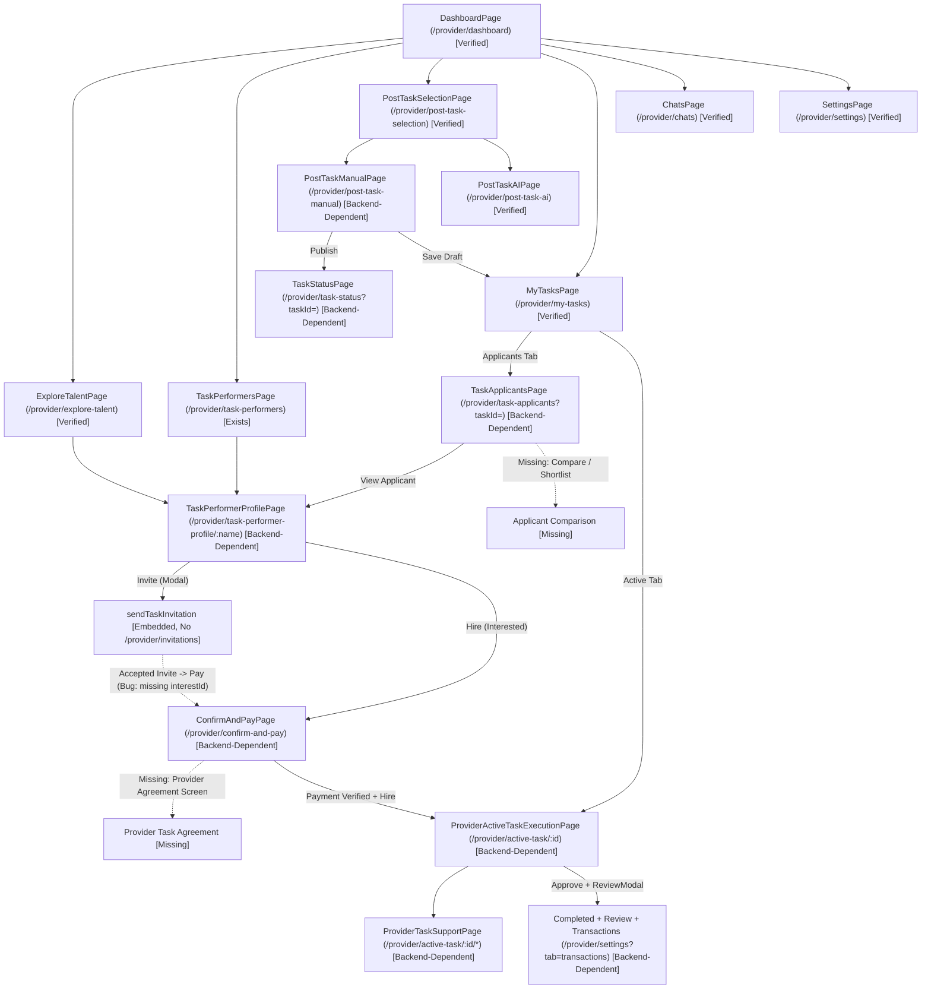

# FirstDoer — Phase 4: Complete Provider Task Lifecycle & Relationship Map

> **Verification Basis:** Direct inspection of `ProviderApp.jsx`, `DashboardPage.jsx`, `PostTaskManualPage.jsx`, `TaskApplicantsPage.jsx`, `TaskPerformerProfilePage.jsx`, `ConfirmAndPayPage.jsx`, `ProviderActiveTaskExecutionPage.jsx`, `PerformerTaskAgreementPage.jsx`, and `provider/services/api.js`.

---

## 1. Stage-by-Stage Lifecycle Verification

### Stage 1 — Discover Performers
- **Pages:** `DashboardPage.jsx` (top 4 performers), `ExploreTalentPage.jsx` (`/provider/explore-talent`), `TaskPerformersPage.jsx` (`/provider/task-performers`), `SearchPage.jsx` (`/provider/search`), `TaskPerformerProfilePage.jsx` (`/provider/task-performer-profile/:name`).
- **Actions:** Search by skill/role, filter by category chip, open Performer profile (About, Portfolio, Reviews, Recent Activities), save/bookmark (`SavedPerformersPage.jsx`), or click `"Hire"` / `"Invite"` to open the Hire Modal inside `TaskPerformerProfilePage.jsx`.

### Stage 2 — Post a Task
- **Pages:** `PostTaskSelectionPage.jsx` (`/provider/post-task-selection`) → `PostTaskAIPage.jsx` (`/provider/post-task-ai`) or `PostTaskManualPage.jsx` (`/provider/post-task-manual`).
- **Flow:** Manual form collects `title`, `description`, `category`, `serviceId`, `taskType`, `budget`, `budgetType`, `deadline`, `skills`, `conditions`, `checklist`, `fileIds` → Step 2 Preview (`isPreview`) → `createTask(taskData)` (`POST /tasks`) or `updateTask(id, taskData)` (`PUT /tasks/:id`) + optional `attachTaskFiles(taskId, { fileIds })` → navigates to `/provider/my-tasks?tab=Draft` (if `DRAFT`) or `/provider/task-status?taskId={taskId}` (if `PUBLISHED`).

### Stage 3 — Receive and Review Applications
- **Pages:** `MyTasksPage.jsx` (`Applicants` tab), `TaskApplicantsPage.jsx` (`/provider/task-applicants?taskId=`), `TaskPerformerProfilePage.jsx` (`?taskId=&source=interest`).
- **Actions:** `getTaskInterests(taskId)` lists interested performers; Provider can reject (`rejectInterest(interestId)`) or open a performer's profile and click Hire (`ConfirmAndPayPage.jsx`).
- **Missing:** Side-by-side applicant comparison table and applicant shortlisting state do **not** exist.

### Stage 4 — Send Performer Invitations
- **Location:** **No separate Provider invitations page exists.** Embedded inside `TaskPerformerProfilePage.jsx` Hire Modal (`openHireModal()` fetches `PUBLISHED`/`OPEN` tasks via `listMyTasks`, `handleConfirmHire()` calls `sendTaskInvitation(taskId, taskerId)`).
- **Status Check:** `checkInvitationAndPay()` calls `getTaskInvitations(taskId)` to see if `status.includes("ACCEPT")`.
- **Performer Side:** Performer receives notification (`DIRECT_HIRE_REQUEST`) → `/performer/invitations` (`PerformerInvitationsPage.jsx`) → `/performer/invitation/:id` (`PerformerTaskInvitationPage.jsx`).

### Stage 5 — Select Performer & Task Agreement (CRITICAL FINDINGS)
1. **Does a separate Provider Task Agreement page exist?** **No.** Provider has no `/provider/task-agreement` route. `ConfirmAndPayPage.jsx` (`/provider/confirm-and-pay`) acts as the pre-hire summary & Razorpay payment screen.
2. **Does a Performer Task Agreement page exist?** **Yes** — `PerformerTaskAgreementPage.jsx` (`/performer/task-agreement/:id`) displays scope, budget, deadline, category, and calls `acceptOffer(assignmentId)` (`PUT /tasks/assignments/:assignmentId/accept-offer`) or `declineOffer(assignmentId)`.
3. **Can Provider review agreement before confirming?** Only task title, description, category, deadline, and pricing breakdown on `ConfirmAndPayPage.jsx` — no formal terms/milestones agreement screen.
4. **Are revisions/negotiation supported?** **No.**
5. **Is there a downloadable PDF agreement?** **No.**
6. **Verified Navigation/State Bug:** `TaskPerformerProfilePage.jsx:306-318` navigates to `/provider/confirm-and-pay` with `hireType: 'accepted_invitation'` and **omits `interestId`**. However, `ConfirmAndPayPage.jsx:236` checks `if (!performer?.interestId)` and blocks payment with an `alert()`, breaking the accepted-invitation hire flow!

### Stage 6 — Task Approval & Assignment
- On `ConfirmAndPayPage.jsx`: `previewTaskPayment` → `createRazorpayOrder` → Razorpay modal → `verifyRazorpayPayment` → `finalizeHire()`:
  - `hireType === 'accepted_invitation'` → relies on backend payment verification to fund existing assignment.
  - `interestId === 'direct_hire'` → calls `directHireTasker(taskId, performer.taskerId)`.
  - Otherwise → calls `acceptInterest(performer.interestId)`.
- Redirects after 4s to `/provider/active-task/${taskId}`.

### Stage 7 — Task Execution
- **Provider:** `ProviderActiveTaskExecutionPage.jsx` (`/provider/active-task/:id`) — tabs: `Task Details`, `Execution Updates`, `Task Checklist`, `Files & Documents`, plus embedded `ActiveTaskChat` (shared), `TaskProgressJourney` (shared), `SubmissionChecklistItemCard` (shared), and support links to `ProviderTaskSupportPage.jsx` (`need-help`, `extend-deadline`, `task-changes`, `performer-issues`).
- **Performer:** `PerformerActiveTaskExecutionPage.jsx` (`/performer/active-task/:id`) — submits checklist items (`tickChecklistItem`), uploads files, posts progress updates (`addTaskUpdate`), and submits final work (`submitTask`).

### Stage 8 — Submission & Review
- Provider reviews individual checklist items via `approveChecklistItem(itemId)` or `requestChecklistItemChange(itemId, ...)` (`RequestChangesModal.jsx`), then signs off checklist via `approveChecklist(checklistId)`.
- For the assignment: Provider can approve (`approveAssignment(assignmentId)` if `SUBMITTED`, else `completeTask(assignmentId)`) or request revision (`rejectAssignment(assignmentId, { reason })` via `window.prompt()`).

### Stage 9 — Completion & Closure
- Upon approval, `ProviderActiveTaskExecutionPage.jsx:505` opens `ReviewModal` → `createTaskReview(id, { rating, comment })`.
- Transaction history & wallet balance are viewed in `SettingsPage.jsx` (`?tab=wallet`, `?tab=transactions`) and task history in `MyTasksPage.jsx` (`Completed` tab) / `TaskHistoryPage.jsx`.

---

## 2. Provider Lifecycle & Navigation Map (Mermaid)

