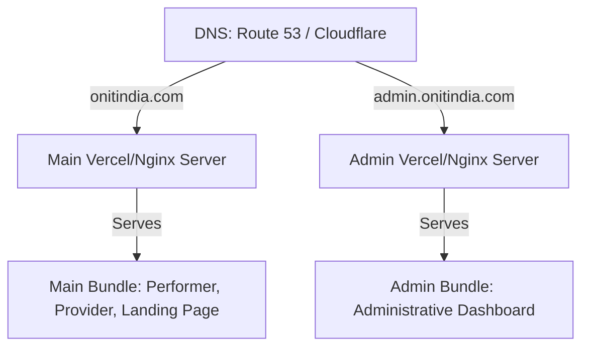

# Subdomain Isolation Implementation Plan: `admin.onitindia.com`

Isolating the Admin Portal to a dedicated subdomain (`admin.onitindia.com`) significantly increases security, separates administrative bundles from client bundles, and allows for targeted network policies (like IP restrictions or VPN configurations).

Below is the detailed technical plan comparing the two best-practice strategies to achieve this.

---

## 🏛️ Strategy 1: Isolated Build Bundles (Monorepo Standard) - *Highly Recommended*

This strategy involves splitting the frontend into two separate SPA projects (or building them as separate entry points in a monorepo). The main site is deployed to `onitindia.com` and the admin portal is deployed separately to `admin.onitindia.com`.

### How It Works:


### Security Benefits:
- **Absolute Bundle Separation:** Regular users browsing `onitindia.com` can **never** download, inspect, or try to reverse-engineer the Admin routes or code because the admin files simply do not exist in the public bundle.
- **Granular Access Control:** You can put `admin.onitindia.com` behind a corporate VPN, restrict access via Cloudflare WAF to specific staff IP addresses, or require client SSL certificates.

### Step-by-Step Implementation:
1. **Repository Structure:**
   Split `client/` into a monorepo structure:
   - `client/packages/main/` (Performer & Provider client applications)
   - `client/packages/admin/` (Admin portal React codebase)
   - `client/packages/shared/` (Shared UI components, context hooks, and styling variables)
2. **Environment Variables:**
   - Main App: `VITE_API_URL=https://api.onitindia.com`
   - Admin App: `VITE_API_URL=https://api.onitindia.com`
3. **Cross-Subdomain Authentication (JWT Cookie Sharing):**
   - Ensure the backend NestJS session/JWT cookie is set on the parent wildcard domain.
   - When setting cookies, specify `domain: '.onitindia.com'`. This allows browser sessions to persist seamlessly when navigating from `onitindia.com` to `admin.onitindia.com`.

---

## 🌐 Strategy 2: Hostname-Driven Dynamic Routing (Single Bundle)

If you prefer keeping a single codebase and build bundle for speed of updates, we can implement **hostname detection** at the React root.

### How It Works:
1. We read `window.location.hostname` inside `App.jsx`.
2. If the hostname is `admin.onitindia.com`, we load *only* `AdminApp.jsx`.
3. If the hostname is `onitindia.com` or `www.onitindia.com`, we load only the public/provider/performer routes.

### Code Implementation Sketch:
```javascript
// App.jsx (Root Routing Switchboard)
import React from 'react';
import { BrowserRouter, Routes, Route, Navigate } from 'react-router-dom';
import AdminApp from './components/Admin/AdminApp';
import ClientApp from './ClientApp'; // Main performer/provider routing switchboard

const App = () => {
    const hostname = window.location.hostname;
    
    // Detect if we are on the admin subdomain
    const isAdminSubdomain = hostname.startsWith('admin.');

    if (isAdminSubdomain) {
        return (
            <BrowserRouter>
                <Routes>
                    <Route path="/*" element={<AdminApp />} />
                </Routes>
            </BrowserRouter>
        );
    }

    // Default: Serves performer, provider, and customer landing pages
    return (
        <BrowserRouter>
            <Routes>
                {/* Block admin routes on the main domain */}
                <Route path="/admin/*" element={<Navigate to="/" replace />} />
                <Route path="/*" element={<ClientApp />} />
            </Routes>
        </BrowserRouter>
    );
};
```

---

## 🔒 Security Hardening on Subdomains

Regardless of the strategy, the following security measures must be deployed:

### 1. DNS & SSL Setup (Cloudflare/Route 53)
- Create an `A` record or `CNAME` record for `admin` pointing to your admin portal deployment.
- Activate wildcard SSL (`*.onitindia.com`) to encrypt all subdomain traffic.

### 2. Backend CORS Policies
Your NestJS backend `main.ts` CORS origins must be updated to explicitly trust subdomains:
```typescript
app.enableCors({
  origin: [
    'https://onitindia.com',
    'https://www.onitindia.com',
    'https://admin.onitindia.com',
  ],
  credentials: true,
});
```

### 3. Wildcard Cookie Session Sharing
To keep users logged in across subdomains, update backend auth token settings:
```typescript
res.cookie('token', jwtToken, {
  httpOnly: true,
  secure: true,
  domain: '.onitindia.com', // Dot prefix enables sharing with all subdomains
  sameSite: 'lax',
});
```

---

## 🛠️ Recommended Action Plan

If you want the **fastest, most seamless** way to test this right now without creating multiple deployment pipelines, we can implement **Strategy 2 (Hostname-Driven Dynamic Routing)**. It separates the routes immediately based on whether you access the site via `localhost` vs `admin.localhost` (in development), or `onitindia.com` vs `admin.onitindia.com` (in production).

Let me know which strategy matches your business goals and I will start implementation!
